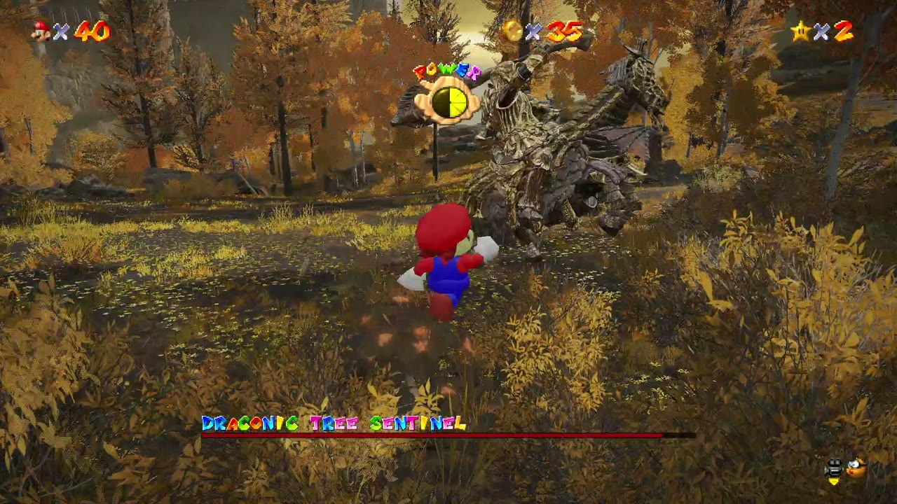
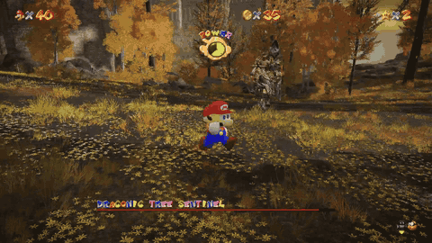
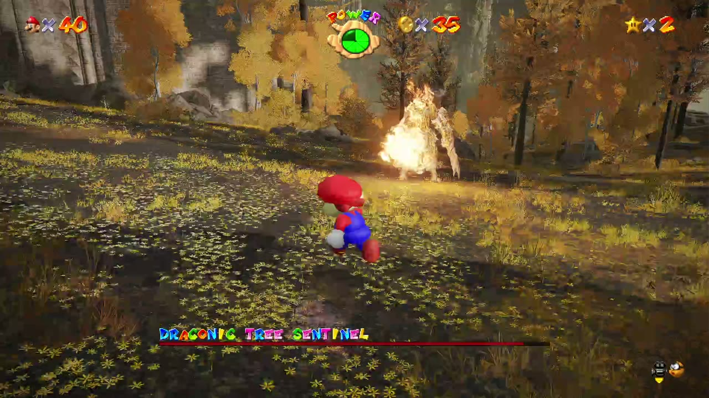
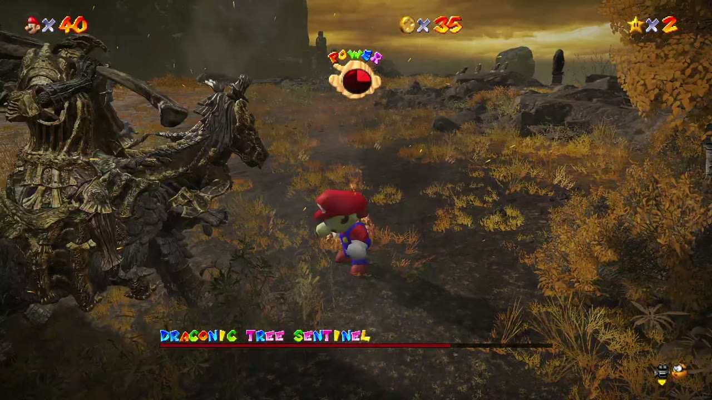
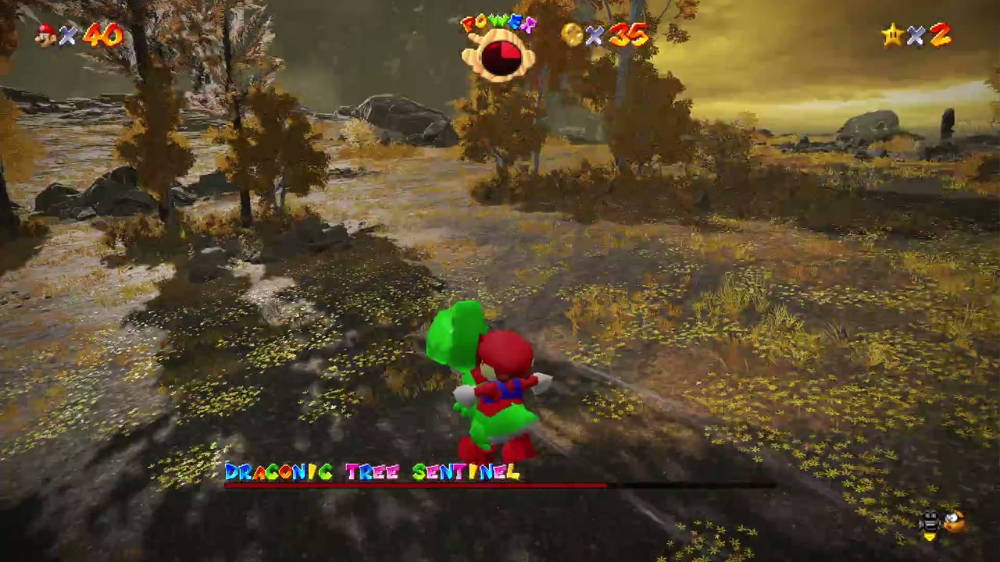
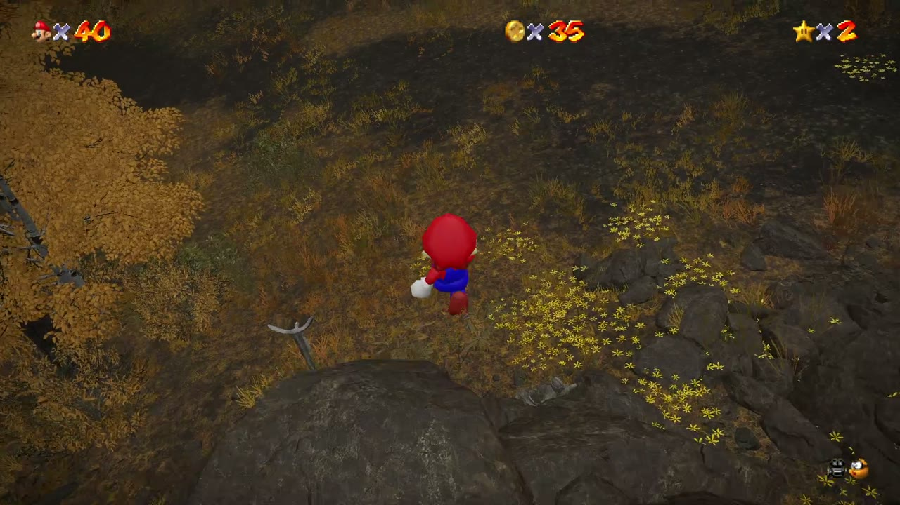

<div align="center">

# ER Mario · Combat Tuned

**Super Mario 64's Mario in Elden Ring, with combat that keeps you on the enemy.**

A fork of [deltarooo/er-mario](https://github.com/deltarooo/er-mario) that reworks how Mario's punches, kicks and stomps feel against Elden Ring enemies.

[](LICENSE)
[](https://github.com/deltarooo/er-mario/releases/tag/v0.4.2)
[](#requirements)
[](#building)



</div>

---

## Why this fork

The original mod puts libsm64 (Super Mario 64's real movement and animation) inside Elden Ring.
It already plays really well. The one thing that felt off was combat: SM64's punches were made
for Goombas and Bob-ombs, not for knights on horseback.

In SM64 a punch pushes Mario **back** from what he hits. In Elden Ring that's a penalty, because
backing away mid-combo gives the enemy free hits. Whiffs were common too: a punch thrown a few
degrees to the side of an enemy standing right in front of you just missed.

This fork makes Mario fight like a character in a hack and slash: every hit moves him forward, and
the combo turns him toward the enemy.

<div align="center">

</div>

## What changed

### Combat feel

| | Original 0.4.2 | This fork |
|---|---|---|
| **Punch knockback** | A landed punch pushes Mario back (SM64's `-48` bounce) | Mario keeps his speed and stays in range for the next hit |
| **Combo step** | Only the first punch steps forward | Every hit (punch, punch, kick) steps forward a little further |
| **Auto-aim** | None | Each hit of the combo turns Mario to the nearest hostile around him (it keeps to the same one during a string), and a blow lunges a step at an enemy just out of reach (fists and hammer, on the ground) |
| **Jump kick** | From a standstill it goes straight up | A small dash forward, aimed like the combo |
| **Punch / kick reach** | 80 units, 50° cone, punches only | 135 units, 60° cone, punches **and** kicks |
| **Head stomp** | Wide hitbox bounced Mario off heads he missed; walked on top of big beasts | Tighter stomp radius, height capped so large enemies can be stomped properly; a stomped enemy dents and springs back (a ground pound flattens a regular one a moment, a big one only dents) |

Auto-aim only targets enemies: regular foes, bosses, hostile groups and invaders. Friendly NPCs,
allies, props, and enemies already down or being carried are left alone.

### New moves

On top of SM64's own moves, Mario gets a hack and slash move set (new libsm64 actions in
`libsm64/src/decomp/game/er_moves.c`, sequences in `src/moves.rs`):

| Input | Move |
|---|---|
| X, X, X, then X again | Punch, punch, kick, then a longer string: spinning backfist, double kick, whirlwind kick |
| X, X, (beat), X | Rush: two fast jabs and a flying kick |
| X, X, Y | Super jump punch. Small or stunned enemies go up with Mario for an air combo (X in the air) |
| Y in the air | Meteor dive |
| Y, X | Mario Tornado |
| B, Y | Koopa shell slide |
| B | Dash, invulnerable, where the stick points. Dashed just as a nearby enemy attacks: a **perfect dodge** (see below) |
| RB (hold) | Fireball, charged 1 / 2 / 4 s; held 10 s, a giant one; held 20 s, the sun (see below). A blow on Mario puts the charge out, and so does any other attack (X, Y, B, RT, L1) pressed while it charges: RB has to come up again. Shots home in gently on the nearest enemy ahead. Thrown with a palm thrust (recoil on the charged ones), in the air it holds Mario up for a moment, X right after goes on with melee |
| A during an air combo | Enemy step: Mario kicks off the enemy for another jump (3 per air combo) |
| B between air blows | With an enemy in the air, the air dash comes back after each blow (3 per jump) |
| D-pad up | Wing cap (recharges in about 55 s) |
| D-pad right | **Mega Mushroom** (see below) |

**Weapons (LB).** A tap of LB takes the next weapon: fists, hammer, Chain Chomp, boomerang. Holding
LB goes back to the fists. A banner shows the weapon's name for a moment.

**Mixing weapons (swap strikes).** Tap LB in the middle of a string, or right after a blow, and
Mario switches on the spot, opening with the new weapon's swap strike while the string goes on
(the next X is the new weapon's next blow), Devil May Cry and God of War style: the hammer comes in
with its overhead smash, the Chain Chomp with its wide sweep, the boomerangs with a fan of three,
the fists with the rush. In the air it's the weapon's air blow (two per jump, four with an enemy up
there). Each swap scores style points and flashes a golden ring.

**Perfect dodge.** Dash (B) just as an enemy close by starts an attack and the world slows down for
a second, Bayonetta's Witch Time: a ring and a glint on Mario (nothing over the screen), a "waha!", and for a moment Mario's blows are
counters that hit 1.6x as hard (`src/dodge.rs`). Once every few seconds at most.

**Hammer.** Mario pulls out a big dark hammer and his X and Y moves turn into hammer
moves: a five-swing string, an earthquake slam (Y), a plunge from the air (Y in the air: the higher
he comes down from, the more the slam charges, and from 12 m up it lands as the giant hammer), a
Donkey Kong flurry that ends with a giant hammer (X, X, Y), a Bowser spin (Y, X) and a
launcher (X, Y): a golf swing that sends enemies flying high, where they hang for a moment so
Mario can jump after them and keep the combo going in the air. When he's
not swinging it, the hammer hangs across his back and he grabs it for each attack.

Holding Y with the hammer charges the slam: Mario squats and trembles with the hammer raised (he can
still turn), it grows with a soft chime per level, and fully charged it comes down as the giant
hammer. Enemies that fall out of an air combo bounce off the ground once, and a hit on the bounce
sends them back up. Launched enemies leave a streak and land with a thud of dust.

**Squash and stretch.** The weapons move like a cartoon's: the hammer stretches out and smears
along its swing and squashes flat on a heavy blow, the Chain Chomp stretches long as it flies and
squashes when it slams into something, its chain's links pull long and thin when taut, and the
boomerangs pop out of Mario's hand. Between throws the big boomerang hangs across Mario's back,
like the hammer, and he grabs it for each throw.

**Real 3D weapons.** The hammer, the boomerangs and the Chain Chomp are 3D models built into
Mario's own mesh, each on a bone of its own (`src/assets/gear.rs`): the boomerangs spin flat and
bank into their curve, the Chomp is a dark iron ball with eyes and teeth whose jaw opens to bite,
on a chain of real links that sags when slack and pulls taut in a lash. Their sounds vary and stay
soft when repeated: the Chomp's chain rattles with SM64's metal clinks, its bark and whooshes come
louder or softer each time, and the boomerangs whir one at a time.

**Boomerang** (the Boomerang Bros.'), the ranged weapon (`src/boomerang.rs`):

| Input | Move |
|---|---|
| X | Throw one, from one hand then the other (it flies up to 22 m). It curves out, hits on the way out and again on the way back. Up to three in the air |
| Y | Three at once in a fan |
| Y (hold) | The big boomerang: Mario whirls round on the spot with it held out (like swinging Bowser by the tail), faster and faster as it grows in his hand, then lets fly. It flies far (up to 43 m) homing in on the enemy, hangs on it for 3 s spinning (following it as it moves, or the next one when it falls), hitting everyone around it again and again |
| X, X, Y | Boomerang launcher: thrown up in an arc, it sends enemies flying up |
| X / Y in the air | Throws in the air; the first few hold Mario up, Devil May Cry style |

Boomerangs and fireballs keep a launched enemy floating where it is, so you can launch one with
the hammer or the boomerang and keep it up from a distance.

**Chain Chomp**, the crowd weapon (`src/chomp.rs`): wide reach, low damage, many enemies at once. It
hops along beside Mario between attacks. Its swings leave a ribbon of fire behind it and throw
sparks off the chain (Kratos' Blades of Chaos), and with the Chomp in hand the hook (RT) is the
Chomp itself: it flies out on its chain, jaws open.

| Input | Move |
|---|---|
| X, X, X | Lunge straight ahead, wide sweep in front, crash down far ahead (shockwave) |
| X, Y | Bite: it lunges low, bites and tosses enemies up for an air combo |
| Y | Cyclone: Mario swings it around himself (steer with the stick), then lets it fly ahead |
| X in the air | It swings once all the way around him |
| Y in the air | Crash: Mario drops with it under him, shockwave on landing |

**Mega Mushroom (D-pad right).** Mario grows to 4 times his height for 15 seconds (90 s
recharge), in SM64 power-up steps with the power-up music. His whole SM64 world is scaled, so
collisions grow with him: low ceilings and narrow passages stop him, and if there is no room
where he stands (a ceiling, walls close by) he won't grow and Lakitu buzzes. Big, he's a titan:
all of him moves at 70% pace (walk, blows, jumps; the music keeps its own), he walks slowly for
his size, fists only, every hit does 2.5x and shakes the screen, enemy hits hurt about a third as
much, his steps crush whoever is under his feet and his landings send a quake through everyone
around (5.5 m), his jumps go up a giant's way, and Y is a
two-fisted slam with a huge shockwave (hold Y to charge it; one every 2.5 s). No dashes, shell,
meteor dive or super jump punch (too fast for a giant), no caps, no Yoshi and no first-person
view while he's big. D-pad right again ends it early, and so do a door, a fog wall, a ladder, a
loading screen or dying. It replaced the Vanish cap.

**The hook (RT).** Mario flings his cap out on a line of light, Devil May Cry's Snatch. It aims
itself: any enemy close to Mario (within 12 m of its body, all around him; one within 5 m first,
then the nearest, those in front before those behind), farther ones where Mario or the camera
looks; one counts as in sight if his hand or his chest sees its middle or high up on it (a bump in
the ground no longer hides an enemy right there); with none, the spot of the map the camera looks
at (up to 20 m):

| It catches | What happens |
|---|---|
| An enemy of any size | Mario flies to it and pops up in front of it for an air combo |
| A wall | Mario flies to it and clings to it a moment: A wall kicks off it, LT lets go |
| A floor or a ledge | Mario flies there and lands |
| **LT held** (any time, ground or air) + RT: a small enemy | Dragged in to Mario; in the air it hangs in front of him, ready for the air string |
| LT + RT: a medium enemy (a stronger or wider regular one, up to 1.4 m wide and 3.4 m tall) | Dragged in too, but the same one only every 5 s, and in the air it drops in front of him (no endless juggle) |
| LT + RT: a big enemy (a boss, a strong one) | Only a tiny hit: it doesn't come and Mario doesn't go |

Walls and ledges are good for **one hook per jump**: after that it only clinks off them until
Mario lands, so there's no climbing forever. Enemies can be hooked any number of times, and each
one gives the wall hook back (jump, wall, enemy, wall again works). It barely hurts: it's for
keeping a combo going and for getting around. It works on the ground and in the air
(`src/hook.rs`).

**Yoshi in a fight (`src/ride.rs`).** Riding Yoshi, A still jumps and B dashes, and Yoshi has his
own moves (his mouth opens for the tongue, he nods with each egg and on a stomp):

| Input on Yoshi | Move |
|---|---|
| X | Tongue: a 3D tube out to 11 m, it locks on to the nearest enemy in a wide cone ahead and follows it closely as it moves (it's hidden behind Yoshi and Mario's bodies), hits whoever it reaches, and every enemy it licks makes him an egg |
| Y (hold for more) | Throw a big 3D egg (white with green spots, tumbling) at the nearest enemy in the cone ahead: it arcs to it and bounces once off the ground. He has up to six (shown under the caps), a new one every 3 s and one per lick |
| RB (hold for more) | Mario's fireball from the saddle, a palm thrust straight at the nearest enemy ahead |
| LT in the air | Stomp: a shockwave all around where he lands |
| LB | Burst of speed for 2.5 s, dust behind him (fast enough to run enemies over), then 6 s of rest |

**Style meter.** Devil May Cry's: every hit in a row scores style points (finishers more, and a
hit of a kind not used in the last four a bonus), and the string earns a rank: D DANDY, C COOL,
B BONKERS, A AWESOME, S SUPER, SS SUPER STAR, SSS WAHOO. It's meant to be earned: the same kind of
blow again within 6 s is worth 20% less each time (down to 30%), a long string on one enemy fades,
the points drain away faster the higher the rank (A 1 point a second, S 2.2, SS 3.6, SSS 5.5) so a
rank is only held by keeping up variety, finishers, skillshots and timing, and being hurt costs the
string and halves the next seconds' points. The MAX shows' knock-on blows score less per blow. Marks: A 30, S 56, SS 88, SSS 130 points; mashing one button tops out
around C, a varied fight reaches A or S, SS and SSS want a fast, varied, skilful one. A new rank
slams in with its word, a soft red coin chime a note higher each time and Mario cheering from S up;
a bar shows the time left before the string drops. Getting hurt ends it ("MAMMA MIA"). From rank
S, a combo's finisher is a **Star Finish**: a golden flash, stars and coins flying out, a banner
and a longer slow motion. A finisher that takes an enemy out, or any kill from rank B up, slows the
world down for a moment (`src/style.rs`).

Hits come with hit-stop, star bursts, shockwave rings, a swing trail and a camera shake on the
heavy ones (`src/impact.rs`). Fireballs are balls of fire in 3D (`src/flame.rs`), low-poly like
SM64's own, in layers: a churning heart (the giant one's magma, dark crust over glowing cracks; the
sun's white-hot plasma), a shell of flame glowing at its rim, tongues of flame streaming back, a
tail, and SM64's flame sprites, embers and smoke round it all. Each charge level is grander than
the last: from the full charge on, rays of light round its rim and its light on the ground; the big
ones' heat ripples off them and warms the screen as they fill it (inside the sun, all fire), and the
sun has arcs of fire looping off its face. Their bursts swell in a flash of fire; the giant one's
and the sun's raise a dome of fire over the ground and billowing smoke (the sun's a mushroom, a
white shock wave racing ahead), with stars. A wall in the way fades a ball by how much of it it
hides (rays to its heart and rim), and faces are cut at the camera instead of lost, so a sun held
right by the camera never vanishes or goes flat. Far off they use fewer faces, and one too small on
screen is a single sprite.

**The camera indoors.** Lakitu senses the room around Mario (walls all around, the ceiling): in a
corridor or a small room it comes closer and lower and stays under the ceiling, a wall right behind
it makes it slide round to where it can see instead of zooming into Mario's back, and it keeps off
walls by the lens. Out in the open it looks a little ahead of where Mario runs and backs off a bit
at full speed, and on a steady run it swings round behind him on its own (God of War style, never
when he runs towards it or right after you turn it yourself). It keeps real time in slow motion, so
it never lags behind Mario. Something in the way (a column, a doorframe) makes it turn a little to
see past it before it dives in close, and it never comes closer than a metre to Mario. Next to a big enemy Lakitu's camera backs off and looks up at it,
more the bigger and closer it is; if one is close but out of view, the camera drifts round to
show it (not right after you turn the camera yourself). In a fight the camera works like God of
War's or Devil May Cry's: it leans towards the enemy you're fighting so both share the screen (with a group around Mario,
towards the group's middle, backing off a little for each enemy),
turns gently to keep it in view, and in an air combo it rises with Mario, backs off a little and
levels out to look up at the fight. A big enemy that gets between the camera
and Mario (or around the camera) turns see-through until it's out of the way.

**Coins as a purse.** The coin counter (kept per character) is now money, and each coin still heals
a wedge. The big abilities cost coins on top of their waits: **Capture 8**, **Mega Mushroom 8**,
**Rock Mushroom 5**, **wing cap 3** (a "NEED COINS" if the purse is short; `src/coins.rs`).
Like Elden Ring's runes, **half the purse is lost when Mario dies and stays in a bag where he last stood**
(a fall into the abyss leaves it at the edge; it keeps its place through loads and warps):
a big spinning coin in a golden glow, marked on the compass with its distance; touching it gives
the coins back. Dying again before that loses that bag for good (the bag isn't kept between
sessions). In co-op every player has a purse and coins of their own: each game drops a coin
where an enemy near that player dies, so Mario and Luigi each see and take theirs.

**Compass.** Elden Ring's compass is hidden with the rest of its HUD, so there is one at the top
middle: a strip with N / NE / E / SE ..., ticks every 15° and the way the camera looks (north is
+Z; if it comes out turned, `compass_north = 180` in `er_mario.ini` turns it).

**Enemy grabs.** Elden Ring's grabs work on Mario: a troll's fist, a beast's jaws, a boss lifting
him up. The game holds him and carries him through its throw while Mario dangles in its grip,
kicking and groaning (SM64's Chuckya grab); one that holds him inside its body swallows him whole,
Bubba style, and he's gone until it spits him out. Let go, he's thrown off with a cry. The throw's
damage counts in wedges (`src/grab.rs`). When the enemy's animation lifts or swings the Tarnished's
body, Mario's pose follows it (`src/engine_mario.rs`), so he's really up in the troll's fist.

**Ailments and fire.** Elden Ring's ailments build up on Mario as on any Tarnished, the game does
their damage (in wedges), and Mario shows them the SM64 way (`src/status.rs`): poison and scarlet
rot make him cough (Hazy Maze's gas) in green or orange puffs, blood loss bursts red (that wedge
costs no knockback), frostbite freezes him stiff for a second and leaves him shivering, sleep
knocks him out (mash buttons to wake up sooner), madness shocks him, and a fire on him sends him
running round in flames like SM64's (the burn's damage is Elden Ring's, not SM64's). Deathblight
stays off.

**Giant fireball.** Held 10 s, RB throws a ball of fire that works like a kamehameha: regular
enemies it runs into are swept along inside it, burning a little at a time; a boss or a big body
stops it and it clings to him, burning, for a second and a half; then it blows up, hurting
everyone within 5 m, and the enemies it carried fly off. It also blows up against a wall or at the
end of its range.

### Combat v3

Timing, gadgets, hook tricks, finishers and power-ups (spec: `docs/superpowers/specs/2026-10-18-combat-v3-design.md`):

| Input | Move | Notes |
|---|---|---|
| A just before an enemy's blow lands | **Mikiri stomp** (Sekiro) | A somersault over the blow onto its head, a stomp that staggers it, a bounce into the air. Bosses' stance cracks (a few open them for the tail grab). 2.5 s cooldown; too early or late it's a plain jump |
| X right as a blow connects | **Action command**: NICE! / GREAT! | +30% on that blow, every third +50%. Mashing locks it out for a moment |
| X at the end of the dash | **Dash strike** (Hades) | A lunging punch with the dash's speed, at most every 1.2 s |
| back + X | **Launcher**, any weapon | Fists: super jump punch; hammer: launcher; Chomp: bite; boomerang: the upward throw |
| forward + Y | **Leap** at the enemy into the weapon's dive | Fists: meteor; hammer: plunge; Chomp: crash; boomerang: fan |
| B toward another enemy mid-string | **Freeflow** (Arkham) | A leap to it (3-12 m), the string goes on |
| 12 blows without being hurt | **MAX finisher** | The weapon twinkles, MAX shows (lost if you're hurt, or after 10 s without landing a blow); its next finisher: fists phantom flurry + launch, hammer cross-shaped quake, Chomp ring of fire flinging the small ones, boomerang three big ones |
| LT crouched + X | **Banana** | Regular enemies slip and fall (the game's own knockdown), big ones stagger, bosses walk over it. 2 at most, 10 s each |
| LT crouched + Y (hold: red) | **Green / red Koopa shell** | Kicked along the floor, off walls and enemies (knockdown), 4 hits; the red one homes in, 2 hits. 8 s |
| LT crouched + B | **Bob-omb** | Lobbed, bounces, goes off after 2 s or on the first enemy: a 3.5 m blast that throws the regular ones up. 12 s |
| LT crouched + RB | **Spring** | Enemies stepping on it fly up; Mario jumping onto it goes higher than any jump. 15 s |
| LT crouched + LB | **Stopwatch** | The enemy in front stops in time (3 s, bosses 1.2 s); blows on it build up momentum and it flies off when time runs again (bosses stagger). 25 s |
| D-pad left | **Rock Mushroom** | 12 s as a boulder: down slopes faster, off walls, a slam after a drop; bowls regular enemies over (3 at once: STRIKE!), bounces off bosses; A hops, X rams; hits cost half. 75 s |
| R3 as a projectile comes | **Parry** (Sekiro / Hollow Knight) | A palm thrust opens a 0.45 s window: an enemy's arrow or spell that reaches Mario (3.8 m) is turned back as a blue-white fireball with a level-3 charge's strength (about 20% on a regular enemy), homing on whoever fired it; a volley is stopped (up to 3 per press) but only one shot goes back. Only shots coming at him, from enemies (not neutral NPCs or the co-op partner); not while swimming, hanging, on a pole or a ladder, or as the Rock. A press that deflects nothing waits 1.6 s, a deflect 1 s. PARRY! (3 style points) |
| LT held + R3 (on his feet) | **Grab** | The nearest enemy in front within arm's reach (the next one if that can't be taken): a small one is carried like a Bob-omb, B throws it far (it flies like the home run, bowls over whoever it meets and lands alive, hardly hurt: the fun is the throw, not the damage); this is the only way to grab: no blow or dive picks one up; a medium or big one stunned, its stance broken (by the game's poise, a Mikiri, a wall slam: a soft chime tells), by the tail, never ridden then: spin the stick, B lets go and it flies (3-8% when it lands) |
| RT on a small enemy, then X | **Home run** | Batted away along the camera, bowling over whoever it meets |
| RT on one enemy, RT on another | **Tether** | The two yanked into each other |
| RT held on a medium or big enemy (after Mario flew to it) | **Pole swing** | Mario swings round it for 4 s, faster and faster. Let go and he's flung off along the swing with its inertia into a flying kick: swing between big enemies, or get away. Held to the end, he lands on its back (Capture) |
| A in the air next to a colossus (an enemy taller than 3.6 m or wider than 1.6 m), or RT tapped on one | **Climb the colossus** (Shadow of the Colossus) | Mario grabs on to the spot nearest him: its bones are the spots (feet, knees, hips, hands, arms, shoulders, back, neck, head, tail: they move with it), and one whose bones can't be read gets spots round its body. Hanging, his **grip** (a ring by him) runs down, faster the harder it thrashes, and comes back standing on its back or head; out of grip, or hit, he falls. A leaps to the next spot (the stick picks which way, else up), B lets go, LT held **slides him down the limb**, spot to spot and faster and faster (A off it jumps with all that speed, RT throws the rope and the slide's speed feeds the swing; off the limb's end he's flung), RT throws the rope from up there. Two **weak points** glow faintly on it (pale gold stars, clearer as he nears them: its head, and its back or a limb): X held on one charges the star strike (he trembles), let go it lands, harder the longer it charged (WEAK POINT!, a stance crack, a slow moment); X tapped anywhere else is a small blow. Every star struck out: **COLOSSAL!**, its stance broken (the tail grab's moment). The camera backs off by its size and sinks below him as he climbs, looking up at the beast |
| RT held as the cap catches a spot high above (a branch, a ledge, a ceiling) or a colossus | **The rope** (Spider-Man, Bionic Commando, a tetherball) | Mario swings from it on a rope, a real pendulum. On a colossus it hangs from its highest steady spot in reach (head, neck, back, shoulders, never a flailing hand) and follows it smoothly: run past one, hook it and the run carries him round and round its body (never through it), the stick pumping the swing. A held climbs up the rope (shorter and faster, off the ground), B held lets more out; on the ground he runs along it, the rope taken up. All the way up, A grabs on to that spot. RT let go: off along the swing with all its speed and a bit more, up (the catapult), in a flying kick that hits whoever it meets. Rope to rope in the air; near a colossus's spot, A grabs on. RT tapped is the zip, as before. The hook's reach and the rope's length go by the place: shut in, 20 m as ever; out in the open by a huge colossus, up to 50 m of hook and 40 m of rope |
| LT + R3 next to a medium or big enemy worn down to half its health (the only way up) | **Capture** (Odyssey) | Only once it's at half its health or less: a gold ring with Mario's face closes in over its head for a moment, with a soft chime, when it gets there (God of War's prompt). Up on its back (RT can be let go) it fights for Mario for 30 s: the stick steers it, X / Y its own light / heavy attacks, which hurt the enemies in its reach in front of it, B a charge that bowls enemies over; blows meant for Mario hit it instead (worn out, he hops off), and its own blows and throws never hurt or unseat him; A or RT again hops off behind it; into a wall: WALL SLAM, its stance broken. One rooted to its spot (a giant plant: it never moved while you fought it) only turns where the stick points, to aim its attacks (no walking, no charge). Big and medium enemies, not bosses with a health bar. 20 s wait after it |

Creative kills get a **skillshot** (style points and a callout): AIR RAID, STOMPED, ROCK BOTTOM,
FRIENDLY FIRE, OUT OF THE PARK, KABOOM, BANANA SPLIT, SHELL SHOCK, PARRY THIS, MAXED OUT, and
DOUBLE / TRIPLE / MULTI KILL; the gadgets have their own (SLIP!, CAROM!, STRIKE!, HOME RUN!,
TETHER!, BOING!, STOP!). Finishers punch the camera in a little. Every gadget and power-up
refuses with a buzz when it can't work. The trap kit's things, the shells and the boulder are real
3D models (built from the ROM-free palette into the gauntlets' piece).

**The sun.** Held on for 20 s (and not hit once: any blow on Mario, even a push that costs no
health, puts out whatever he's charging), the giant one grows into an immense ball held high over
his head. It flies slowly and works the same way, clings longer, and its explosion reaches 9 m:
waves of fire roll out, the regular enemies near its heart are flung away, and pools of lava are
left on the ground for 2-3 s, burning whoever steps in them.

**Shoves.** An enemy's blow that costs no health (a push, a shield bash) now makes Mario reel back
too (SM64's soft knockback, no wedge lost).

**Big blows hurt more than wedges.** A heavy hit from a boss or a big brute sometimes (a roll of
the dice, never twice in a row) sends Mario flying far off, screaming; if a wall is in the way he
smacks into it with stars and a bonk (`src/blown.rs`). And a fall from very high up (over 22 m)
is the end of him, as in Elden Ring.

### Damage balance

Every hit takes a share of the enemy's max HP. Bosses take a small fraction of that, more for the
close and risky hits.

| Attack | Original | This fork |
|---|---|---|
| Punches, kicks, combos, hammer (X and Y) | 67% of enemy HP | **1-23%** per hit. A regular enemy takes about 10 punches; finishers hit hardest, the super jump punch's rising blows barely scratch. The game's own hit that goes with a blow (its reaction, its aggro) carries only 5% of the bare fist now: at 100% it added the whole fist on top (a third of a regular enemy's health per punch in Reforged) |
| Grab and throw (LT + R3, B) | — | **1.5%** on landing, never a kill; whoever it bowls over takes the bowled share and goes down |
| Boomerang | — | **2-4%** per pass (it hits going and coming back); the big one about 2% per hit while it hovers |
| Counters (after a perfect dodge) | — | **x1.6** for 1.6 s |
| Chain Chomp | — | **2-10%**, on every enemy it reaches; the cyclone the least |
| Long strings | — | Past 10 hits on the same enemy each hit is worth 5% less than the one before (down to 40%, finishers 70%), so long combos last instead of melting the enemy |
| Stomp | 50% of enemy HP | **20%**; bouncing on the same enemy without landing halves it each time (100%, 50%, 25%... down to 10%) |
| Ground pound | 67%, no boss bonus | **31%**, boss bonus **×2**, shockwave hits enemies around |
| Fireball | — | **9-25%** by charge; the giant one burns **6%** every quarter second while it carries or clings, and its explosion does **64%** to everyone within 5 m; the sun's explosion does **75%** within 9 m and its lava pools **4%** every half second (on bosses about 8% and 0.3%) |
| Elden Ring hits on Mario | 1 or 2 full wedges | **a quarter of a wedge** or half of one: Mario has **40% more health** and takes **30% less damage** (`src/tough.rs`: every loss of health, from any source, is cut to half; the meter keeps its eight wedges, each worth more). A lethal fall still kills. Luigi in co-op too |
| Mikiri stomp | — | **9%** and a heavy stagger; on bosses a stance crack |
| Action command | — | **+30%** of the blow (every third **+50%**) |
| Dash strike | — | **12%** |
| Trap kit | — | Banana **6%** + knockdown, shell **7.5%** a hit + knockdown, Bob-omb **21%** in its blast, spring **2%** |
| Rock Mushroom | — | **7%** a roll-over (once a second per enemy) + knockdown, slam **12%** |
| Hook moves | — | Home run **10.5%** (+6% landing, never a kill), bowled **6%**, tether **9%** each, swing kick **13.5%** |
| MAX finishers | — | Flurry **2%** ×6 + **7.5%**, cross quake **7%** a step, Chomp ring **10.5%** |
| Capture: its attacks **5% / 8.5%**, charge **6%** each, wall slam | — | **11%** and the stance broken |

(The shares below were worked out with a 0.75 damage factor; the current one is 0.6, 0.42 with Reforged, whose enemies are meant to hold out longer (ini `damage_factor`), so take 20% off each (44% with Reforged; throws, the pole swing's impact, Yoshi's trample and the bat keep theirs); bosses take about 13% of them, more for the
risky close ones.) Any one enemy is knocked down at most every 3.5 s, whatever does it.

The ground pound is slow and leaves Mario open, so it's worth the risk.

### Fixes and quality of life

- Elden Ring only lets the player create about 256 bullets a session (their emitters are never
  freed), and every blow of Mario's that the game registers, and his footstep noise, is one. Once
  they ran out, blows no longer woke or staggered enemies and Mario made no noise. They're now
  rationed: a light blow registers on the same enemy at most every second (heavy blows and
  finishers always), and the noise only plays with an enemy within 20 m that Mario isn't already
  fighting. Known limit: a very long session can still run out.

- **Enemies notice Mario like a normal player.** The game never walks the Tarnished in Mario
  mode, so enemies never heard his steps and only fought back once hit. Now Mario makes the
  game's own AI noise (`src/noise.rs`): soft when he walks, louder when he runs, jumps, lands
  or fights, loudest on heavy blows. Standing still or crawling is silent, so sneaking still works.

- **Yoshi kept coming back on his own.** Punching (X) while getting off Yoshi queued the game's
  "use item" whistle, and he was summoned again every few seconds. X now reaches the game only
  while Mario whistles.
- **No more random slides.** Elden Ring's ground is full of small steep triangles that started a
  slide in the middle of a walk or a fight. A slide now needs a slope steeper than ~40° held for a
  few ticks (SM64's rules still apply once Mario is sliding).
- **Audio survives device changes.** Unplugging headphones or switching the default output used to
  leave Mario silent for the rest of the session. The audio thread now reopens the stream.
- **Quieter background sounds.** Lakitu's camera clicks play at 25% and Yoshi's footsteps at 40%;
  the style meter's and the charges' chimes play softly.
- **A shorter game over.** Bowser shows up sooner after Mario's death (1.6 s) and his iris closes
  faster (1 s); the log records the whole timeline from death to respawn.
- **Fewer hitches in fights.** The game's raycast check of each collision triangle is remembered,
  so fast combat moves no longer re-check hundreds of triangles every few frames.

All gameplay changes live in `src/combat.rs`, `src/lib.rs` and a few small, commented
`er-mario:` patches inside `libsm64/src/decomp/game/` and `libsm64/src/fake_interaction.c`.

## Gallery

<table>
  <tr>
    <td width="50%"></td>
    <td width="50%"></td>
  </tr>
  <tr>
    <td width="50%"></td>
    <td width="50%"></td>
  </tr>
</table>

## Everything from the original mod

Triple jumps, wall kicks, long jumps, ground pounds, punches and kicks that hurt enemies, SM64's
health meter and coins, Lakitu's camera, Bowser's tail swing on staggered bosses, Bob-omb style
enemy throws, Yoshi in place of Torrent, Mario's own model, and Bowser laughing at you instead of
YOU DIED. See the [original README](https://github.com/deltarooo/er-mario#readme) for the full
feature list, controls and known issues.

## Requirements

- **Elden Ring** on Steam, exe version **2.7.1**. On any other version the mod switches itself off.
- **[me3](https://me3.help)**, the mod loader.
- **Your own Super Mario 64 ROM, US version** (`.z64`, `.n64` or `.v64`). Mario's model, textures,
  sounds and icons are built from it on your PC the first time you play. No Nintendo data ships
  with this repository.
- An Xbox-layout controller, or mouse and keyboard.

> [!WARNING]
> **Offline only.** me3 starts Elden Ring offline with Easy Anti-Cheat off, and the mod uses its
> own save file (`ER0000_mario.sl2`). Never play it online and never load the Mario save in the
> normal game.

## Install

1. Install the original mod by following its
   [Getting started](https://github.com/deltarooo/er-mario#getting-started) guide (me3, the
   release zip, your ROM, the first launch setup).
2. [Build](#building) this fork and copy `er_mario.dll` over the one in your **ER-Mario** folder
   (`.\build.ps1 -Dist <ER-Mario folder>` does it for you).
3. Launch with **er-mario.me3** as usual.

The mod still checks the original repository for new releases. Updating to an upstream release
replaces this fork's DLL with the original one.

## Controls

| Controller | Keyboard and mouse | Action |
|---|---|---|
| Left stick | W A S D | Move |
| A | L / right mouse | Jump (double, triple, wall kick, long jump) |
| X | , / left mouse | Punch, punch, kick (auto-aimed combo, see [New moves](#new-moves)). Running: dive. A punch out of a run brakes him into the blow (no sliding past the enemy). Right on a blow's impact: NICE!. Back + X: launcher |
| Y | | Special move: breakdance sweep, slide kick (running), combos with X and B. Forward + Y: leap into the weapon's dive |
| B | | Dash: a quick lunge where the stick points (ahead without it), invulnerable; X at its end: dash strike; A out of it. Mid-string toward another enemy: freeflow |
| A just before an enemy's blow | | Mikiri stomp |
| RB (hold) | | Fireball, charged 1 / 2 / 4 s; held 10 s, a giant one that sweeps enemies along and blows up; held 20 s, the sun, which leaves lava pools |
| D-pad | | Left Rock Mushroom, up Wing cap, right Mega Mushroom, down takes the cap off (and interact) |
| R3 | | Parry; with LT held, the grab |
| RT | Middle mouse button | The hook (see above), with LT held it pulls the enemy to Mario. Then X on a small one: home run; RT on another: tether; held on a big one: pole swing. Held as it catches a spot high up or a colossus: the rope (stick pumps, A held climbs, B held lowers, RT up lets go with the swing's speed) |
| LT held (crouched) + X / Y / B / RB / LB | | Trap kit: banana, shell (hold Y: red), Bob-omb, spring, stopwatch |
| LB | | Next weapon (fists, hammer, Chain Chomp, boomerang); hold to go back to the fists. Mid-string: a swap strike |
| LT | K | Crouch, ground pound in the air (not when the press goes with RT or R3: the pull, the grab) |
| Right stick | Arrow keys | Lakitu's camera: left / right turn it smoothly round Mario (faster the further you push; the way Elden Ring's own camera turns: its System > Camera "reverse X axis" option flips it, on is SM64's old way), down zooms out, up zooms in (and into the first-person view). In a fight the camera backs off to keep Mario and the enemy in view, more the farther you've zoomed out |
| D-pad down | E | Interact: talk, pick up, graces, doors (on the pad it also ends the cap, the Rock or the Mega Mushroom). It presses the game's own interact button, Y; if you moved it in the game's controls, set `pad_interact = A` (B, Y, LB, RB, BACK, START) in `er_mario.ini` |
| L3 (left stick click) | R | Whistle for Yoshi (co-op: on release; held 0.6 s, warp to your partner) |
| Menu > Inventory > Use | same | Any item used from the inventory (Seamless Co-op's Tiny Great Pot and Effigy of Malenia, too): the game gets its use-item request while the menu is up and a second after it closes. A button still held from confirming in a menu (or ending a talk) doesn't make Mario jump: it's ignored until let go |
| X / Y / RB / LT / LB on Yoshi | X: , or left mouse; Y: middle mouse; LT: K | Tongue, eggs, Mario's fireball, stomp, burst of speed |
| | F9 | Switch between Lakitu's and Elden Ring's camera |
| | F1 (hold 3 s) | Give up and respawn at the last grace |

## Luigi and co-op (experimental)

Play [Seamless Co-op](https://www.nexusmods.com/eldenring/mods/510) as Mario and Luigi, also on
top of [Elden Ring Reforged](https://www.nexusmods.com/eldenring/mods/541). Step-by-step setup
(in Spanish): [docs/coop/README.md](docs/coop/README.md).

- `character = luigi` in `er_mario.ini` makes you Luigi, in green and navy with an **L** on his
  cap, a touch slimmer than his brother (the next two launches rebuild the model). Mario wears the
  Vagabond chest piece, Luigi its Altered version, and every install also builds the other brother,
  so each player sees the other as who they play.
- Luigi plays like Luigi: his jumps go a fifth higher, his skids on a stop or a turn are longer
  (slippery shoes), holding **A** as a jump comes down makes his legs kick like mad and hold him up
  for a moment (his flutter, once a jump), low on health he stands there shivering instead of
  panting, and his voice is a little higher (on the partner's game too).
- Each player's Mario pose goes to the other over Steam (the game's own `steam_api64`,
  SteamNetworkingMessages on a channel of the mod's), ~30 times a second, with where they are (map
  chunk coordinates) and their clock. The other game shows them a moment back in time, between the
  two poses around then (snapshot interpolation, 50 ms or more if packets come unevenly), at their
  own place, not where the game's slower updates have their Tarnished: no stutter or lag.
- The partner's pose is put back right after the game animates their Tarnished, as your own is
  (it used to flicker into the Tarnished's shape now and then, their shadow too).
- Each one's Mario sounds (voice, steps, blows) go to the other too, always softer than your own
  and fading with the distance (none past 50 m), and so do the mod's own (the weapons' clinks and
  whooshes, the hammer's quakes, fireballs, explosions, power-ups), at their own volume; the
  player's own cues (buzzes, chimes) stay theirs.
- The partner's wing cap shows its wings (drawn over their model), the Vanish cap makes them
  see-through, the Mega Mushroom makes them big, and their Torrent is Yoshi on your game too
  (posed with Yoshi's own walk, idle and jump from how it moves, its hooves silent).
- Their effects show too, around where they're shown: fireballs, the hook's line, the boomerangs'
  streaks, the hammer's and the Chain Chomp's ribbons and sparks, the blows' star bursts, stars and
  coins, rings on the ground, the dash, Yoshi's tongue and eggs. They go in a packet of their own,
  20 times a second, at most 1000 bytes (the newest of each kind kept; fireballs go as what they
  are, about 20 bytes a ball, and are drawn in 3D on the other side): with them in the pose, a
  fight's poses outgrew one network packet and were lost whole, and the partner froze mid combo.
  The pose alone is 873 bytes. Every 20 s the log sums up what went out and came in
  (`net: last 20 s sent ...; got ...; lost poses N, effects M`).
- Their place is their own: their place in their map block (physics position less the game's
  world origin shift, its "chunk position": the same on both games, physics positions aren't),
  worked out through your own Tarnished in the same block, however far the game's slower copy of
  them lags (at a join it stands on the host). In another block, the game's copy shows them. That copy is then moved there too: Mario is drawn on its model, and the game
  leaves it out by where it stands (they went invisible), and your enemies see them there. A pose
  without a place holds where they were for half a second, and a change between their own place
  and the game's blends instead of jumping. The log says which one is used (`coop: partner ... shown at their own place ...`).
- **Revive**: out of health with a partner who can help, you don't die: you go down (SM64's death
  pose, stars circling over your head, untouchable) and have 30 s. Your partner comes over and
  holds **D-pad down** next to you for a second (a ▼ RESCUE prompt and a ring filling): you're
  back up with three wedges, SM64's 1-UP, a spin into the air, stars and coins. Nobody in time,
  both down, or a death the game deals itself (a fall into the void): the real death, Seamless
  Co-op's spectating and respawn as before.
- **Leash**: past 30 m a TOO FAR warning, from 35 m the way out gets stiffer until it stops at
  40 m (coming back is always free); more than 48 m apart for 2 s (a fall, a zip, Torrent), the
  one who isn't fighting (both or neither: the guest) warps to the other through SM64's pipe in a
  puff of smoke. Never in a boss fight, while either is down, riding, in a menu, a door or a
  cutscene. Holding **L3** (R) for 0.6 s warps you to your partner right away (stuck behind a
  wall, lost), under the same rules; a quick tap still whistles for Yoshi.
- Lakitu frames your partner close by too: the view leans their way and backs off a little (it
  never turns for them: you keep the camera).
- The host owns the enemies: the guest's blows are sent to the host, who takes them off and deals
  the final blow. As the guest you can't grab enemies or launch them (they'd jump back to where
  the host has them), but every blow counts.
- A blow on your partner only pushes them.
- Two players are a bit harder than one: Mario's blows (shares of max HP) act as if enemies had
  35% more health per extra player (bosses 100%, `coop_health_scaling` / `coop_boss_health_scaling`
  in `er_mario.ini`), and the guide sets enemies to hit
  15% harder. Alone, nothing changes.
- With Reforged, put `er_mario.dll`, `er_mario.ini` and your ROM in Reforged's `dll\offline`:
  the mod then builds its models into Reforged's `addons\er-mario`, which Reforged's launcher
  loads (`package_dir = ...` in `er_mario.ini` overrides it). `base_assets = ...` makes the build
  start from another mod's menu, material or Torrent files instead of the game's.
- On Reforged, enemies have about 1.7 times vanilla's health, so the line where an enemy counts as
  a boss (smaller damage share, never lifted by the uppercut) doubles to 5000 HP when Reforged's
  DLL is loaded (`enemy_hp_scale` in `er_mario.ini`). Reforged's one-off health drains no longer
  set Mario on fire, and invisible characters (the helpers by graces, enemies the game isn't
  drawing) are left alone.
- Mario's blows land on anyone not on your side, as a weapon's would, whatever team the game
  puts them on (Caelid's soldiers at war with its hounds, the giants with swords...), except the
  friends' teams, a captured enemy, spirit ashes and Torrents, and, on teams not known to be
  enemies, the human NPCs (merchants, quest NPCs) and those with a name of their own in the
  game's NpcParam (Blaidd, Alexander...; no field enemy has one). One of those who hits Mario is
  an enemy from then on (the log says `combat: ... hit Mario: it's hostile from now on`). `hostile_teams = 30,48` / `friendly_teams = ...` in
  `er_mario.ini` add exceptions, should a team come out wrong.
- Both players need the same ER Mario build, the same Seamless version and the same regulation
  (both Reforged, or both vanilla: `docs/coop/er-mario-coop.me3` is the vanilla profile).
- The Metal cap is retired (D-pad left is the Rock Mushroom), so its look isn't sent. Packets are
  version 10: both players need the same build.


Co-op touches (nothing of this shows alone):
- Landing on your partner's head is a **Bros. Jump** (a high bounce off it).
- **Bros. Attack** (Mario & Luigi's): three BROS! in a row and that enemy is marked, both
  brothers' faces over its head in a ring turning red and green, for 8 s. A Bros. Jump off your
  partner's head then (easier to land while it's up) flips you up and over onto it (12 m at most):
  the world slows at the top, you come down in a ground pound homing in on it, and it takes a
  team finisher's blow (about 30% of a regular enemy, a boss's own smaller share), with rings in
  both colours, stars and a shake. The one jumped off gets **BROS POWER** for 5 s: their blows up
  close hit 1.3 times harder. Then 25 s before the next one. `damage_bros_attack` in
  `er_mario.ini` sets its share.
- A boss down with your partner close by: both star dance with "SUPER BROS!", gold and both
  brothers' rings and a fountain of stars and coins.
- Reviving: a trail of stars from you to them, "NICE ONE!" on your side and "THANKS, BRO!" on
  theirs.
- Back together after over 8 s more than 30 m apart: a ring and stars at their feet and a soft
  chime.
- **Partner card**, bottom left, only while something's going on (a fight, either of you hurt,
  them low, down or over 30 m away), fading out 5 s after it's quiet: their head (Mario or Luigi),
  power pie, the power they're using (cap, Rock, Mega, Yoshi, a capture), coins and style rank. Red
  and pulsing when they're in danger (2 wedges or less, or just hurt), grey and crossed out when down.
- In danger and in view: their pie over their head. Out of view: an arrow on the screen's edge with
  how far they are (red and quicker in danger, grey when down).
- On the compass: their head (with the distance past 30 m) and their coin bag (a coin ringed in
  their colour).
- **BROS!** over an enemy you both hit within 1.5 s (style points); a streak of them counts as
  "BROS x N" under the style meter (the word only on the first and every fifth).
- Callouts: "LUIGI!" (low), "LUIGI DOWN", "LUIGI IS BACK" (or MARIO), "1UP" over the one you
  revive. Down yourself: HELP and your seconds left up top. A downed partner's edge arrow is green.
- Both players need the same build: the packets are version 10 (the status packet: health, coins,
  power, style, last enemy hit, coin bag, down and its seconds left, boss fight, busy, a few times
  a second; the effects; the revive; the mod's own sounds with their volume; the Bros. Attack's
  leap and blow; the fireballs as balls, bursts and lava pools, each list's records sized so a later
  build can add fields an older one skips). From version 4 on a build skips a
  kind of packet it doesn't know and reads a longer one as far as it knows, so later additions
  (grabbing and throwing your partner) can come without breaking it.

## Building

Windows, with [Rust](https://rustup.rs), Visual Studio Build Tools (C++),
[LLVM](https://github.com/llvm/llvm-project/releases) (clang-cl compiles libsm64's C code) and
Python. Cargo fetches fromsoftware-rs itself (pinned to a commit in `Cargo.toml`).

```powershell
git clone https://github.com/LucioFex/er-mario
cd er-mario/libsm64
python import-mario-geo.py
cd ..
.\build.ps1
```

On Linux, install [`cargo-xwin`](https://github.com/rust-cross/cargo-xwin) plus `python3`,
`clang` and `llvm`, then use `build.sh` instead of `build.ps1`.

`import-mario-geo.py` downloads Mario's model code from the SM64 decompilation once and strips
his vertices, light colours and textures out of it: those are read from the player's ROM at
runtime. The model code isn't part of this repository.

## Credits

- **[Delta (deltarooo)](https://github.com/deltarooo)**, author of [ER Mario](https://github.com/deltarooo/er-mario). Almost everything here is their work.
- [libsm64](https://github.com/libsm64/libsm64) (CC0) by the libsm64 contributors, built on the
  [Super Mario 64 decompilation](https://github.com/n64decomp/sm64) by the n64decomp team
- [fromsoftware-rs](https://github.com/vswarte/fromsoftware-rs) (MIT / Apache-2.0) by Vincent
  Swarte and contributors
- [me3](https://me3.help) by the me3 team
- [hudhook](https://github.com/veeenu/hudhook) (MIT) by veeenu
- [BenjaminMassey](https://github.com/BenjaminMassey): controller direction fix and the Linux build script (upstream)
- The Grand Archives' Elden Ring cheat table, for the item and inventory function patterns
- Combat tuning in this fork: [Luciano Esteban (LucioFex)](https://github.com/LucioFex)

## License

[MIT](LICENSE), same as the original. It covers the mod's own code only, not Super Mario 64's or
Elden Ring's content: Mario's model, textures, sounds and animations come from the player's ROM,
and nothing of FromSoftware's is included. The `libsm64` folder keeps libsm64's own license, CC0
([libsm64/LICENSE.md](libsm64/LICENSE.md)).

<sub>Super Mario 64 and Mario are Nintendo's. Elden Ring is FromSoftware's. This is a free fan mod,
not affiliated with either.</sub>
